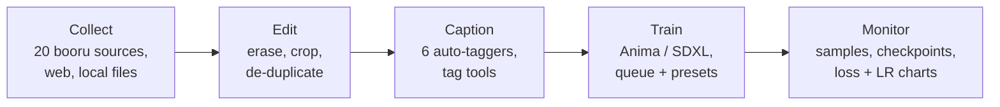

<div align="center">


# Anima Studio

**The whole LoRA pipeline in one local app.**
Collect → Edit → Caption → Train → Monitor, for **Anima (DiT)** and **SDXL**.


</div>

---

## What it is

Anima Studio is a small local web app (Python/Flask backend, plain HTML/JS frontend) that runs on your own machine, in a browser tab or its own desktop window. A folder you work on in one tab follows you into the next, so a dataset goes from "images on a booru" to "trained LoRA" without leaving the app.

Nothing about your images, tags or models leaves your machine except the requests you explicitly make: booru search, tagger model download, and your own training backend.



## Feature sheet

| | Tab | What you get |
|---|---|---|
| 🔎 | **Booru Explorer** | A booru-style browser with random / trending / top-score feeds, tag autocomplete, a tag sidebar by category, tag wiki, pools, saved searches and a local blacklist. |
| ⬇️ | **Collect** | Search 20 booru sources at once (or a web page, URL list, or local files). **Smart curation** picks a balanced subset: ticked filter tags are alternatives (any one of them), then it de-duplicates and balances views, outfits and poses. |
| ✂️ | **Edit** | Paint-out watermark eraser, Windows-Photos-style crop with aspect lock, **duplicate finder** (dHash), and **multi-resolution export** (512 / 1024 / 1536 / custom copies of your dataset). |
| 🏷️ | **Caption** | Per-image and bulk caption tools, **Tag Frequency** view (strike a tag from every caption in one click, rename everywhere), caption-variation detection, and auto-tagging. |
| 🧪 | **Train** | One form for every setting, grouped into Dataset / Model & network / Training / Output / Advanced. Presets, a job **queue**, `.toml` import/export, pre-run warnings, and a Studio tab. |
| 📈 | **Monitor** | Live step / loss / ETA, newest run's **loss and learning-rate charts** (TensorBoard), sample images and saved checkpoints. |
| ⚙️ | **Backend** | Installs, starts and stops the bundled training engine and shows its log. |

## Screenshots

> Captured from the running app with a small synthetic demo dataset.

### Collect


### Edit


### Caption


<details>
<summary><b>Tag Frequency view</b></summary>


</details>

### Train
The Training tab is split into five sub-tabs. Related options sit together, and each tick option sits next to the settings it controls.

<table>
<tr>
<td align="center"><b>Dataset</b><br></td>
<td align="center"><b>Model &amp; network</b><br></td>
</tr>
<tr>
<td align="center"><b>Training</b><br></td>
<td align="center"><b>Output</b><br></td>
</tr>
</table>

<details>
<summary><b>Advanced</b></summary>


</details>

### Monitor


### Projects and Backend
<table>
<tr>
<td align="center"><b>Projects</b><br></td>
<td align="center"><b>Backend</b><br></td>
</tr>
</table>

## Specifications

| | |
|---|---|
| **Models** | Anima (DiT, with Qwen3 text encoder and Qwen-Image VAE) and SDXL |
| **Training engine** | Vendored [sd-scripts](https://github.com/kohya-ss/sd-scripts) fork with custom optimizers and schedulers, from `67372a/LoRA_Easy_Training_Scripts` (see `THIRD_PARTY_NOTICES.md`) |
| **Network types** | 17 algorithms (LoRA, LoCon, LyCORIS variants and more) |
| **Optimizers** | 113 (5 recommended defaults), including CAME, Prodigy, ScheduleFree and `adv_optm` |
| **LR schedulers** | 14, including Rex annealing with warm restarts (cycle length is set automatically) |
| **Loss types** | 14, plus min-SNR, debiased estimation, masked loss, noise offset and Huber |
| **Sample samplers** | 16 |
| **Dataset sources** | 20 booru sites (Danbooru, Gelbooru, Safebooru, Konachan, yande.re, e621 and more), web pages, URL lists, local files |
| **Auto-taggers** | WD ViT / SwinV2 / ConvNeXt / EVA02-Large v3, EVA02 2026 canary, and **PixAI tagger v1.0** |
| **Image tools** | Magic eraser, crop with AI or classical upscale, duplicate detection, multi-resolution export |
| **Monitoring** | Progress, loss and learning-rate charts (TensorBoard), samples, checkpoints |
| **Run control** | Queue with reorder / cancel / retry, presets, `.toml` import and export |
| **Packaging** | `run.bat` / `run.sh`, `desktop.py` (own window via pywebview), or a standalone `.exe` via `build_windows.bat` |
| **Frontend** | Vanilla JS, no build step, themeable via Appearance |
| **Tests** | 44 passing, 2 skipped without torch; needs no GPU |

## Quick start

**Windows:** double-click `run.bat`. **macOS / Linux:** `./run.sh`.
Or manually:

```bash
pip install -r requirements.txt
python run.py            # opens http://127.0.0.1:7864
```

On first run, open the **Backend** tab and press **Install** once. This sets up the bundled training engine's own environment (PyTorch and the rest of the ML stack, a multi-GB download that has to match your GPU). Nothing is installed automatically. After that the backend starts with the app.

Optional: `pip install tensorboard` for loss charts, `pip install pywebview` then `python desktop.py` for a native window.

## Notes on training quality

- The bundled trainer includes a fix for Rex annealing with warm restarts: its cycle length defaulted to one step, which collapsed the learning rate to nearly zero. The app now sets it to the full run length.
- Captions are read exactly the way the trainer reads them (`image.png` needs `image.txt`). The Train tab warns by name when one is missing.
- With "Cache latents" on, random crop and colour/gamma augmentation are dropped, because they can't apply to cached latents. The UI says so.

## Project layout

```
app/                 Flask app: routes/, services/, schema, TOML config, static/ (JS + CSS), templates/
native_backend/      Trainer server that drives the training engine
training_backend/    Bundled sd-scripts fork (own venv, installed from the Backend tab)
tests/               pytest suite (no GPU needed)
docs/                GUIDE.md (full usage guide) and screenshots
run.py / run.bat / run.sh   start the app          desktop.py   native window
anima_studio.spec / build_windows.bat               standalone Windows build
```

## Docs

- [`docs/GUIDE.md`](docs/GUIDE.md) - full usage guide, each tab in detail
- [`THIRD_PARTY_NOTICES.md`](THIRD_PARTY_NOTICES.md) - vendored code and licences

## Tests

```bash
pip install pytest
python -m pytest
```

## Licences

Anima Studio bundles third-party code; see `THIRD_PARTY_NOTICES.md`. Models (Anima, Qwen3, VAEs, taggers) have their own licences, so check them before any commercial use.
