<div align="center">

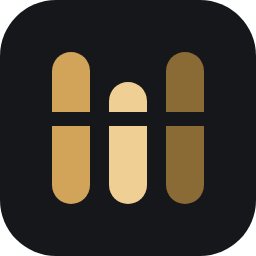

# Anima Studio

**The whole LoRA pipeline in one local app.**
Collect → Edit → Caption → Train → Monitor, for **Anima (DiT)** and **SDXL**.


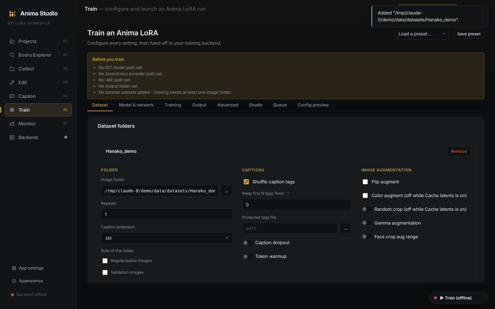

</div>

---

## What it is

Anima Studio is a small local web app (Python/Flask backend, plain HTML/JS frontend) that runs on your own machine, in a browser tab or its own desktop window. A folder you work on in one tab follows you into the next, so a dataset goes from "images on a booru" to "trained LoRA" without leaving the app.

Nothing about your images, tags or models leaves your machine except the requests you explicitly make: booru search, tagger model download, and your own training backend.

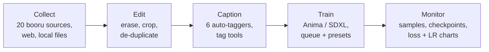

## Feature sheet

| | Tab | What you get |
|---|---|---|
| 🔎 | **Booru Explorer** | A booru-style browser with random / trending / top-score feeds, tag autocomplete, a tag sidebar by category, tag wiki, pools, saved searches and a local blacklist. |
| ⬇️ | **Collect** | Search 20 booru sources at once (or a web page, URL list, or local files). **Smart curation** picks a balanced subset: ticked filter tags are alternatives (any one of them), then it de-duplicates and balances views, outfits and poses. |
| ✂️ | **Edit** | Paint-out watermark eraser, Windows-Photos-style crop with aspect lock, **duplicate finder** (dHash), and **multi-resolution export** (512 / 1024 / 1536 / custom copies of your dataset). |
| 🏷️ | **Caption** | **Edit tags** on any image (auto-saved) or across the whole dataset, **Tag Frequency** view (strike a tag from every caption in one click, rename everywhere), caption-variation detection, auto-tagging, and **natural-language captions** written from the tags or by a local vision-language model. |
| 🧪 | **Train** | One form for every setting, grouped into Dataset / Model & network / Training / Output / Advanced. Presets, a job **queue**, `.toml` import/export, pre-run warnings, and a Studio tab with packaging, slimming and **metadata removal**. |
| 📈 | **Monitor** | Live step / loss / **self-correcting ETA**, a **GPU health strip** (VRAM, utilisation, temperature, power), the newest run's **loss and learning-rate charts** (TensorBoard), sample images and saved checkpoints. |
| ⚙️ | **Backend** | Installs, starts and stops the bundled training engine, shows its log, and **verifies its own integrity** - files, venv, torch + CUDA, packages, process, reachability and disk - with the fix for whatever is missing. |

## Screenshots

> Captured from the running app with a small synthetic demo dataset.

### Collect
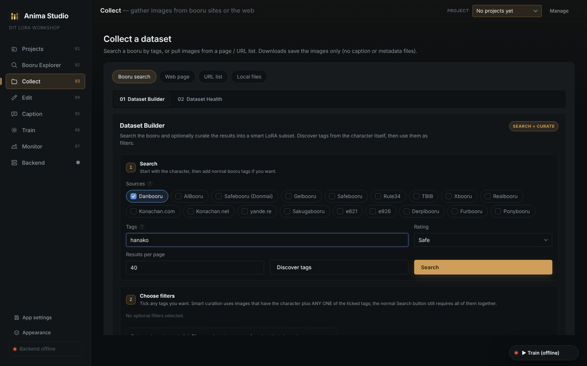

### Edit
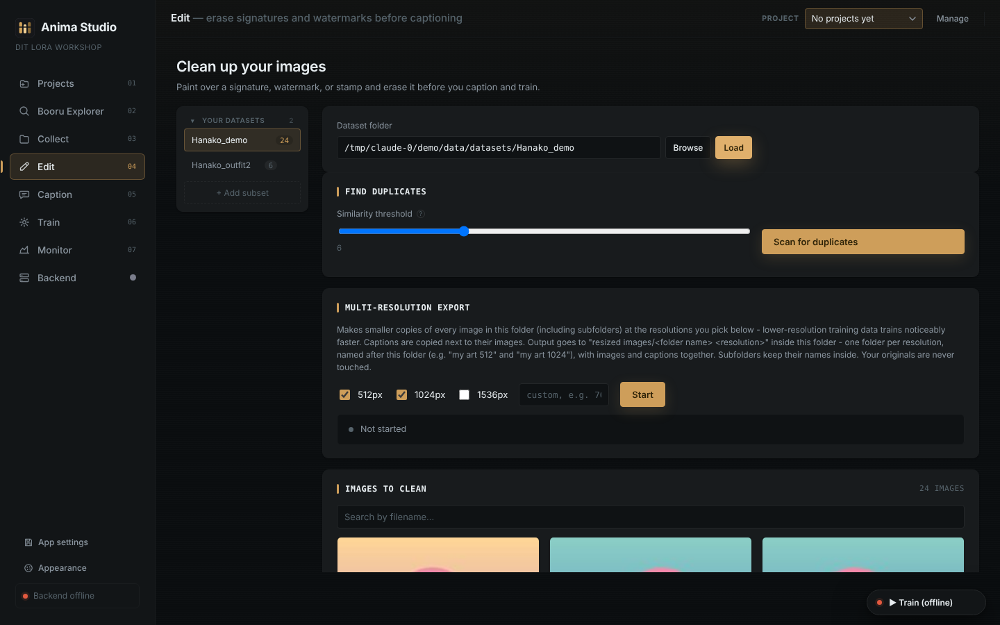

### Caption
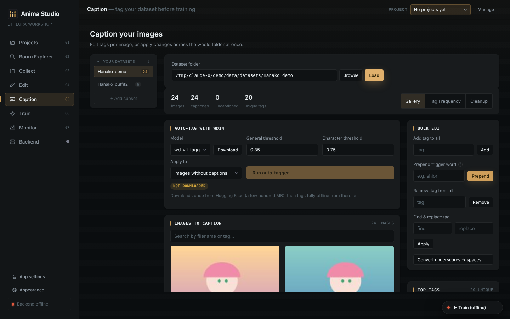

<details>
<summary><b>Tag Frequency view</b></summary>

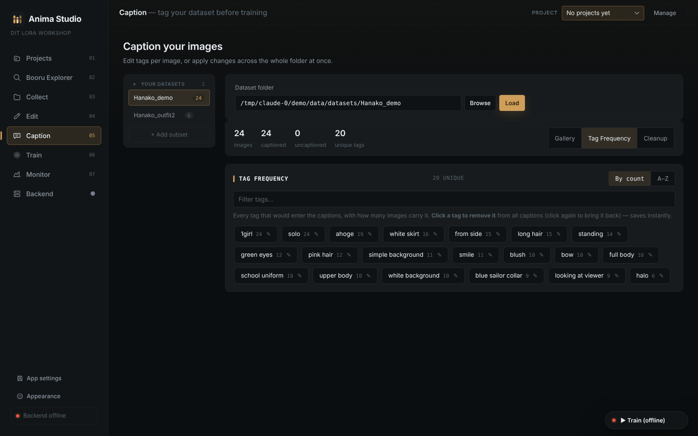

</details>

### Train
The Training tab is split into five sub-tabs. Related options sit together, and each tick option sits next to the settings it controls.

<table>
<tr>
<td align="center"><b>Dataset</b><br></td>
<td align="center"><b>Model &amp; network</b><br>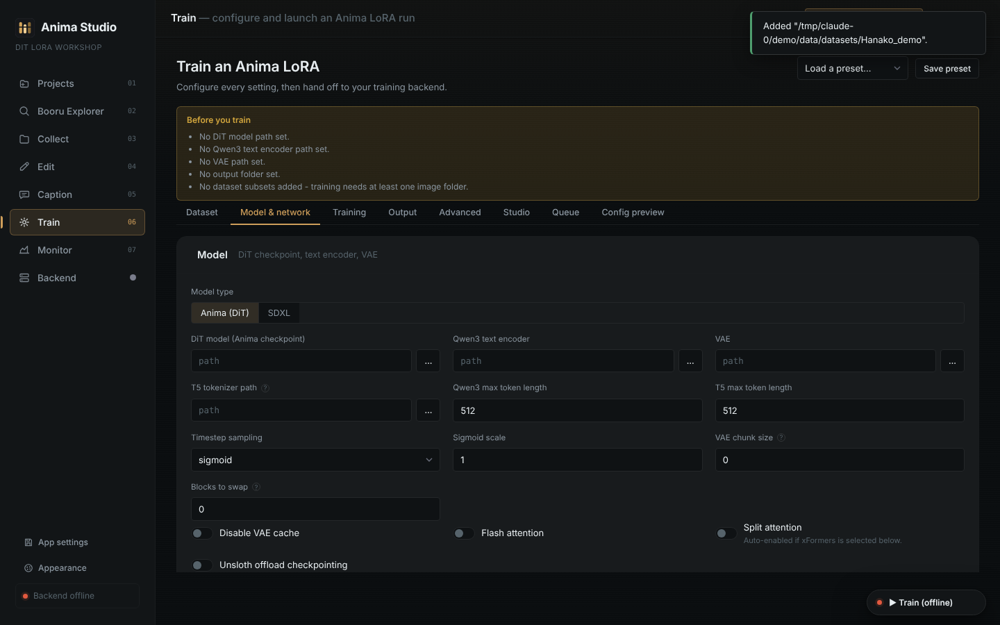</td>
</tr>
<tr>
<td align="center"><b>Training</b><br>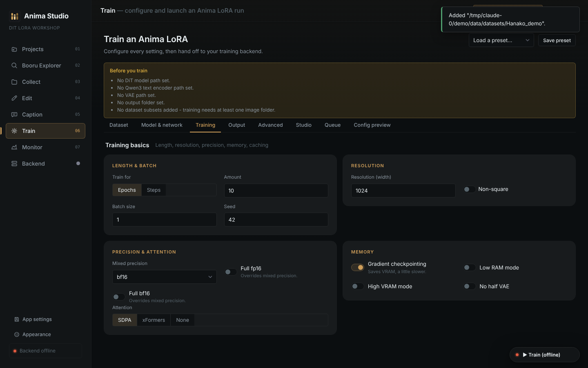</td>
<td align="center"><b>Output</b><br>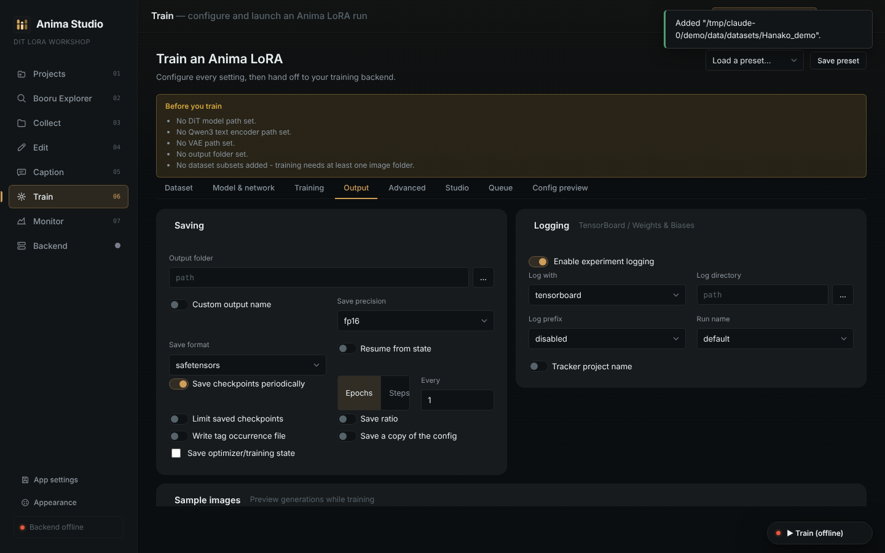</td>
</tr>
</table>

<details>
<summary><b>Advanced</b></summary>

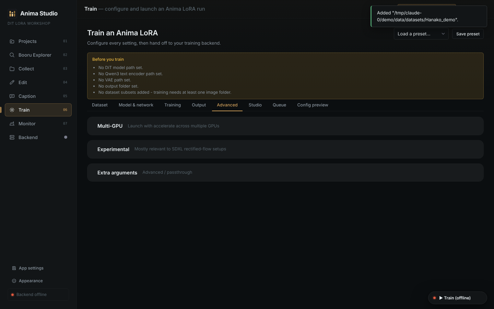

</details>

### Monitor
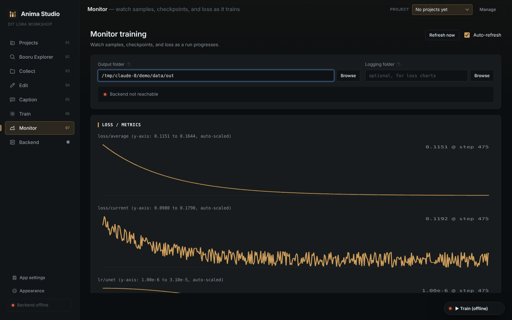

### Projects and Backend
<table>
<tr>
<td align="center"><b>Projects</b><br>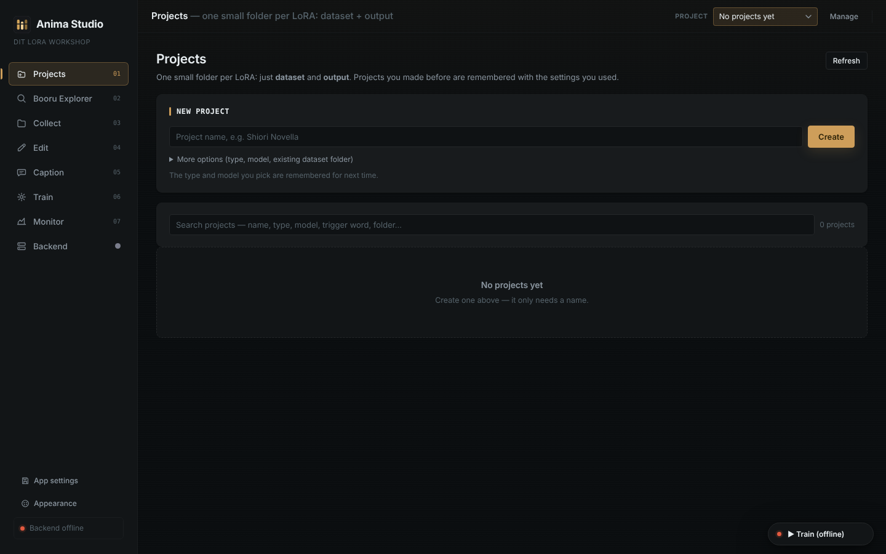</td>
<td align="center"><b>Backend</b><br>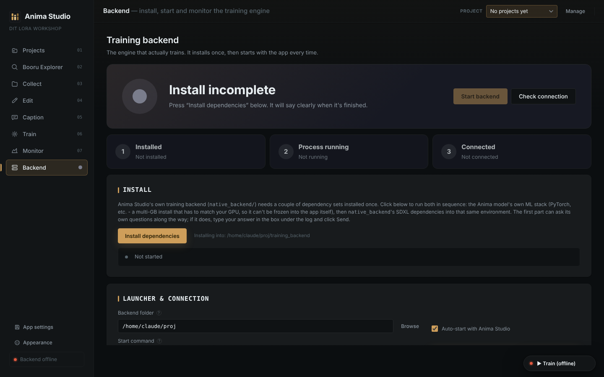</td>
</tr>
</table>

## Complete feature reference

Every tab, every option. (Built from the app's own screens, so it matches what you see.)

### Projects
- One folder per LoRA, with a fixed `dataset` and `output` layout created for you
- Project **type** (Character / Outfit / Style / Concept / Object / Other) and **model** (Anima / SDXL), remembered for next time
- Link an **existing dataset folder** instead of creating an empty one
- Search projects by name, type, model, trigger word or folder; most recently opened first
- Every project remembers the settings you used
- **Active project** switching fills in the folder of every tab (Collect, Edit, Caption, Train, Monitor). It never overwrites a path you typed yourself, and tells you when it left one alone

### Booru Explorer
- Opens already filled with **random posts**; one-click feeds: Random, Trending, Latest, Top score, Most faved, plus Shuffle
- **20 sources** with a source picker; **rating filter** (Safe / Sensitive / Questionable / Explicit / Any), default Safe; **minimum score** filter
- Tag search with **live autocomplete**, exclusion (`-tag`), and **Open on site** to jump to the booru's own page
- **"Characters in this feed"** cards to jump straight into a character
- Sidebar of the page's tags grouped by category (artist, copyright, character, general, meta) with **+ add, - exclude and ? wiki** on every tag
- **Tag wiki** when searching a single tag: text, aliases, post count, category, related tags, artist links
- Full-screen **viewer** with categorized tags (artist, copyright and character tags show their **total posts on the site**), score, size, source, parent/children posts, pools, and **previous/next with the arrow keys** (Esc closes)
- **Pools** browser, **Saved searches**, a local **Blacklist** (posts with those tags are hidden)
- Select posts with **+** on a card, then **Add to dataset** into any destination folder (Browse, Clear selection)
- **Connection panel** for blocked sites: Automatic mode switches to encrypted DNS (Cloudflare / Google / Quad9), a **Test connection** button shows which part works, and a **proxy** setting is used for searches and downloads
- Error panel with Retry, "which sites can I reach" check and proxy box
- Per-site **API keys** (for sites that now require them), stored locally

### Collect
- Four ways in: **Booru search**, **Web page**, **URL list**, **Local files**
- **Multi-source search**: pick several boorus and the results are merged
- Live tag suggestions, results per page, rating filter, Prev / Next paging
- **Eye icon** on any result to preview full size and select it for download from there
- **Thumbnails and previews** load through the app's image proxy (with each site's own Referer), so hotlink-protected CDNs like Danbooru's still show up; if an image really can't be fetched, it is retried and the reason is shown
- **Downloads are checked** before they land in the folder: a half-finished file, an empty file, or a web page served instead of an image is reported as failed instead of saved as a broken image
- **Select all / Clear**, choose the destination folder, **Download selected / Download all**
- **Web page**: paste a URL and **Scan page** to list its images; **URL list**: one image URL per line
- **Local files**: pick images from your computer and add them to a dataset
- **Dataset Builder**
  - **Discover tags**: samples the character's posts and groups useful tags (outfits, views, footwear, poses, expressions, details, other) with counts
  - **Filters**: tick any tags; smart curation takes images with the character plus any one of them (normal Search still requires all)
  - **Smart curation**: target image count (1 to 1000), search pool (up to 5000), minimum resolution; removes low-quality and duplicate images and balances coverage, with a coverage readout (back, side, full body, footwear, outfits, actions, expressions, details)
  - Notice when Danbooru's anonymous 2-tag limit applies (extra tags become a filter on each result)
- **Smart Dataset Manager** (Dataset Health): see below

### Dataset Health (Collect > Smart Dataset Manager)
- **Health score** 0 to 100 with a letter grade
- **Quick** analysis or **Full** analysis (adds near-duplicate scan using perceptual hashing)
- **Distribution** charts: resolutions and aspect ratios
- **Balance analyzer**: tag-group distribution with dominance warnings
- **Dataset coverage map**: how well each aspect of the concept is covered, with the evidence images one click away
- **Cleanup plan**: suggested keep / remove / review for every image, **Select duplicates only**, **Remove selected**, **Save selection** to another folder. Nothing is deleted without your confirmation
- Drop a folder or images onto the path row

### Edit
- Load any folder; **search by filename**; click an image to open the editor; **arrow keys** (and on-image arrows) move to the next or previous image
- **Magic eraser**: paint over a watermark or signature with a **brush** (adjustable size) or a **rectangle**, choose the **Telea** or **Navier-Stokes** method, then Erase; **Undo** and **Clear**
- **Crop** with a resizable, draggable selection and corner/edge handles, **aspect lock** (Free, 1:1, 4:3, 3:4, 16:9, 9:16), then Apply crop
- **Upscale** the crop: Off, 1.5x, 2x, 3x, 4x with **Lanczos** (sharp), **Bicubic** (soft) or **AI (UltraSharp)** (optional model download and one-click dependency install)
- **Zoom** in/out and Fit
- **Save as copy** keeps the original untouched; **Revert to original** restores from automatic backups
- **Send crop to folder / subset** files the crop straight into another dataset folder
- **Delete** removes an image and its caption file
- **Find duplicates**: similarity threshold slider (resizes, recompressions, minor edits), then review and delete
- **Multi-resolution export**: 512, 1024, 1536 or a custom size; copies the whole folder tree at each size with captions alongside, one folder per resolution inside `resized images/`, with a progress status. Originals are never touched
- **Subset sidebar** (also in Caption): collapsible groups "Your datasets" and "Inside <folder>", **+ Add subset** from anywhere on disk, **Hide empty folders**, hide or remove a row with the x, "Show N hidden"

### Caption
- Stats bar: images, captioned, uncaptioned, unique tags; three views: **Gallery**, **Tag Frequency**, **Cleanup**
- **Edit tags on any image:** each image has its own caption box. Type to add, remove, reorder or reword tags and it **saves automatically** as you type. Search by filename or tag content to find the image you want
- **Edit tags across the whole dataset** without opening every image: add, remove, find and replace, rename (pencil in Tag Frequency), strike, standardise variants, and convert underscores to spaces
- **Auto-tagging** with 6 models: WD ViT v3, WD SwinV2 v3, WD ConvNeXt v3, WD EVA02-Large v3, WD EVA02 2026 canary and **PixAI tagger v1.0**
  - One-click model download with progress, then fully offline; the timm/PixAI models' extra packages install once from the **Backend** tab (Feature dependencies)
  - General and character **threshold** sliders; apply to **images without captions** or **all images (overwrite)**
- **Natural-language captions** (the NL caption card): turn the existing tags into a sentence with no model at all - hair, framing and background tags fold into clauses ("mychar, a girl with long blue hair in twintails, shown full body, on a grey gradient background") - or download a local vision-language model (**Florence-2-large**, **Qwen2.5-VL-3B-Instruct** or **JoyCaption beta**) and caption straight from the picture. Each run either **replaces** the caption or **keeps the tags and appends the sentence**, with an optional trigger word kept at the front. Live preview before you commit; the vision-language model fills only the images you choose, while rephrasing always covers every image that has tags; runs in its own process so its VRAM is handed back when the batch ends
- **Bulk edit**: add a tag to all, **prepend a trigger word** (always the first tag), remove a tag from all, find and replace a tag, convert underscores to spaces
- **Tag Frequency**: every tag as a chip with its count, sort by count or A to Z, filter box; **click a tag to strike it from every caption** (click again to restore it to exactly the images it came from); **pencil** to rename a tag everywhere
- **Tag variation detection** (Cleanup): finds tags meaning the same thing (white_hair vs silver_hair), tick groups and **Standardize selected**
- **Chip editor** on every image: type and press Enter to add a tag, **autocomplete** suggests tags already in your dataset (most common first), **drag chips to reorder**, click × to remove, **Ctrl+Z** undoes the last change on that image, and **Aa** switches to plain text
- **Tag a region**: in the zoomed viewer click "Tag a region" and drag a box around a detail the tagger misses on the whole image. Only that crop is scored (with the tagger model chosen in Auto-tag), and the closest tags appear ranked with their scores; ★ marks tags the whole image missed. Click one to add it to the caption. A **search box** under the results looks through the tagger's whole vocabulary (type `plate` or `crotch`) and shows how that crop scores for each match, so a correct tag that ranked too low to show up can still be found
- **Zoom an image** and edit its tag chips right beside it; **← → keys or the arrow buttons** move through the images (respecting your search and tag filter), Esc closes
- **Multi-select** images (hover the circle, shift-click for a range), then add or remove a tag on just those; **copy one image's tags and paste them onto the selection**
- **Images-for-this-tag filter**: the ▦ button on a Tag Frequency chip shows only the images with that tag
- **Undo** for every bulk change (add, remove, find and replace, auto-tag, cleanup tools)
- **Colour guard** for auto-tagging keeps one eye colour and one hair colour per image and drops low-confidence blue/green skin
- **Redundant tags** (tick which: `shirt` beside `white shirt`), **Tag variations** (click which spelling to keep), **blacklist** (applied automatically after auto-tagging if you like), **remove repeated tags** and **tag relationships** (which tags always travel together)
- **Auto-sort** in the Bulk edit card: reorders every caption — the first tags stay put, then subject, hair, eyes, body, clothing, expression, pose, other, setting, meta
- Top tags panel

### Train
- **Anima (DiT)** or **SDXL** at the top; the whole form adapts
- **Presets**: **Save preset** stores your whole configuration under a name, and **Load a preset** brings it back
- **Before you train** panel lists problems by name (missing model paths, no dataset, a caption file that is missing or empty and what it should be called)
- Sub-tabs: Dataset, Model & network, Training, Output, Advanced, Studio, Queue, Config preview

**Dataset**
- Add any number of **dataset folders**, **Use current dataset**, **Add all subsets**
- Per folder: image folder, **repeats**, **caption extension**, role (**regularization** or **validation** images), **shuffle caption tags**, **keep first N tags fixed**, **protected tags file**, **caption dropout** (rate, per-tag), **token warmup**, **flip**, **color augment**, **random crop** (with padding), **gamma augment**, **face crop range**, **paired / control-net data**
- **Aspect-ratio bucketing** with min / max resolution, step, **don't upscale small images**, and **multi-resolution training**

**Model & network**
- Model files: **DiT**, **Qwen3 text encoder**, **VAE**, **T5 tokenizer**, max token lengths, **timestep sampling**, **sigmoid scale**, **discrete flow shift**, **VAE chunk size**, **blocks to swap**, **disable VAE cache**, **flash attention**, **split attention**, **Unsloth offload checkpointing**
- Network: **17 algorithms** (LoRA, LoCon, LyCORIS variants and more), LyCORIS preset, **rank and alpha**, min/max timestep, train target, **separate conv dim and alpha**, rank and module dropout, constraint, **Tucker decomposition**, **train norm layers**, **DoRA**, rescaled, **bypass mode**, network dropout, IP noise gamma, **DyLoRA** unit, **cache text encoder outputs** (also to disk), **LoRA-FA**
- **Per-block** LR weights (down / mid / up), dims, alphas, conv dims and conv alphas
- **Optimizer** (113 options, 5 recommended), learning rate, **max grad norm**, **separate UNet / text-encoder LR**, optimizer arguments
- **LR scheduler** (14) with warmup ratio, **warm up from zero**, cycles, poly power, min LR, gamma, curve shape, decay ratio and type, timescale, min LR ratio, initial LR
- **Loss** (14 types) with Huber c and schedule, **scale weight norms**, **min-SNR gamma**, **zero terminal SNR**, **masked loss**

**Training**
- **Length** by epochs or steps, **batch size**, **seed**, **gradient accumulation**
- **Resolution** with non-square support
- **Precision and attention**: mixed precision, full fp16, full bf16, SDPA / xFormers / none
- **Memory**: gradient checkpointing, low RAM, high VRAM, no half VAE
- **Caching and loading**: cache latents (also to disk), cache text-encoder outputs, dataloader workers
- Prior loss weight, keep-tokens separator, training comment, protected tags file, external VAE override
- **Noise offset**, **pyramid (multi-res) noise** with iterations and discount, **EDM2 loss weighting** (optimizer, LR, channels, warmup, constant phase, initial weights)

**Output**
- Output folder, custom output name, **save precision**, **save format** (safetensors), **resume from state**
- **Save checkpoints periodically** by epochs or steps, **limit saved checkpoints**, save ratio, write tag-occurrence file, **save a copy of the config**, save optimizer/training state, limit saved states
- **Logging**: TensorBoard or Wandb, log directory (defaults to `<output>/logs`), prefix, run name, tracker project name
- **Sample images during training**: sampler (16), every N epochs or steps, sample prompts

**Advanced**
- **Multi-GPU** (accelerate): number of GPUs, main process port
- **Experimental**: VAE batch size, custom VAE scale/shift, VAE reflection padding, zero conditioning dropout, **debiased estimation**
- **Extra arguments** field for anything not on a form; unknown options are forwarded to the trainer

**Studio**
- **Images and steps calculator**: images, repeats, epochs, project type, batch size, gradient accumulation and steps per second give total steps and an **estimated duration**
- **Training history**: every run is recorded; **Compare selected** runs side by side
- **LoRA packaging**: pick a `.safetensors`, read its metadata to auto-fill the form, add package name, trigger words, description and dataset folder, and bundle a shareable, self-describing folder (and zip)
- **LoRA slimmer**: analyze a standard LoRA/LoCon and see, per option (fixed rank or "keep N% of the change"), the resulting size, space saved and how much of the learned change survives; pick one (a recommendation is starred), optionally convert to fp16/bf16, and a new smaller file is written next to the original. The original is never overwritten. LoHa/LoKr/DoRA files are not supported
- **Metadata remover**: read every key stored inside a `.safetensors` - training comments, dataset paths, hashes, your own notes - then write a copy with the metadata stripped (`<name>_nometa.safetensors`). Tick the keys to keep. The original is never touched

**Queue**
- **Add current config to queue** (a snapshot), jobs train one after another
- Reorder (up / down / top), rename, cancel, retry, **Pause queue**, **Clear finished**; pauses itself if the backend is down

**Config preview**
- Live TOML preview, **Download .toml**, **Load .toml** (upload or from disk), **Save .toml to disk**; settings round-trip exactly

**Training bar (every tab)**
- A **Train** pill that expands on hover with **Start training** and **Add to queue**; while training it shows progress, step / epoch / loss, estimated time remaining (or elapsed time for trainers that only report start and finish), the queue, and the card's **GPU utilisation, VRAM and temperature** - the read-out drops its parts as the window narrows so the run's own numbers always stay
- **Stop** button; from another tab, Start asks you to confirm it will use the Train tab's settings
- Error panel with a plain-language hint (out of memory, missing package, unknown optimizer) and a **Copy** button for the log

### Monitor
- Output folder and logging folder (the log folder falls back to `<output>/logs`)
- **Status** light, **step / epoch / loss** progress bar with a **self-correcting ETA**: a least-squares rate over a rolling window of samples, damped so a slow step does not throw the estimate, and honest when it cannot know - "saving a checkpoint?" after a stall, elapsed time for trainers that only report start and finish
- **GPU health strip**: VRAM in use (with a bar), utilisation, temperature, power draw and fan speed, read from `nvidia-smi` - no torch, no extra packages. The dot turns red past 85°C, and the whole strip hides itself on a machine with no NVIDIA GPU
- **Loss and metric charts** for the newest run only, with y-range in each title and clean scientific notation for tiny values; clears and re-checks when a new run starts
- **Latest samples** grid with click-to-zoom, **checkpoints** list with size and age
- **Auto-refresh** that only polls while the tab is open, plus Refresh now

### Backend
- Three-step status: **Installed**, **Process running**, **Connected**
- **Install dependencies** with live log and an input box to answer the installer's questions; nothing installs automatically
- **Feature dependencies**: one card for the optional packages the tagger's timm models, the vision-language captioner and the AI upscaler need - status, Install button and live log in one place, so the feature tabs only show a short note when something is missing
- **Verify integrity**: one click checks the backend's files, its virtual environment, torch + CUDA, the packages, the custom scheduler, whether the process is running, whether it answers, and free disk space - each with a plain-language fix when something is missing
- **Start / Stop**, **Auto-start with Anima Studio**, editable start command, backend URL, **Check connection**, and a backend log

### App-wide
- **Appearance**: background colour, accent colour, six presets, Reset to default, saved between launches
- **App settings**: Collect / Edit / Caption / Explorer settings and the **Monitor output and log folders** are saved automatically per project and globally (plus a **default log folder** you set once - Train and Monitor both use it), and as **named presets**. **"Always load these settings when opening the app"** is on by default; turn it off to start fresh, or pick a preset to load at startup. Secrets and the folders that follow your project are never captured
- **Desktop window** via pywebview, **standalone `.exe`** build, or plain browser tab
- Folder browser with new-folder button, drag and drop of folders and images
- **Warnings by name**: a missing or misnamed caption file is reported with the exact name it should have (`a.png` needs `a.txt`), and the trainer log prints how many images have captions
- **Run it once, no surprise installs**: opening the app never downloads anything; `run.bat` installs its own dependencies once (`run.bat --update` to refresh)
- Local-only: nothing leaves your machine except searches, model downloads and your own backend
- Test suite (56 tests, no GPU needed)

## Specifications

| | |
|---|---|
| **Models** | Anima (DiT, with Qwen3 text encoder and Qwen-Image VAE) and SDXL |
| **Training engine** | Vendored [sd-scripts](https://github.com/kohya-ss/sd-scripts) fork with custom optimizers and schedulers, from `67372a/LoRA_Easy_Training_Scripts` (see `THIRD_PARTY_NOTICES.md`) |
| **Network types** | 17 algorithms (LoRA, LoCon, LyCORIS variants and more) |
| **Optimizers** | 113 (5 recommended defaults), including CAME, Prodigy, ScheduleFree and `adv_optm` |
| **LR schedulers** | 14, including Rex annealing with warm restarts (cycle length is set automatically) |
| **Loss types** | 14, plus min-SNR, debiased estimation, masked loss, noise offset and Huber |
| **Sample samplers** | 16 |
| **Dataset sources** | 20 booru sites (Danbooru, Gelbooru, Safebooru, Konachan, yande.re, e621 and more), web pages, URL lists, local files |
| **Auto-taggers** | WD ViT / SwinV2 / ConvNeXt / EVA02-Large v3, EVA02 2026 canary, and **PixAI tagger v1.0**; natural-language captions from tags or from a local VLM (Florence-2-large, Qwen2.5-VL-3B, JoyCaption beta) |
| **Image tools** | Magic eraser, crop with AI or classical upscale, duplicate detection, multi-resolution export |
| **Monitoring** | Progress, self-correcting ETA, loss and learning-rate charts (TensorBoard), samples, checkpoints, GPU telemetry (VRAM, utilisation, temperature, power) |
| **Run control** | Queue with reorder / cancel / retry, presets, `.toml` import and export |
| **Packaging** | `run.bat` / `run.sh`, `desktop.py` (own window via pywebview), or a standalone `.exe` via `build_windows.bat` |
| **Frontend** | Vanilla JS, no build step, themeable via Appearance |
| **Tests** | 56 passing, 20 skipped without torch; needs no GPU |

## Quick start

**Windows:** double-click `run.bat`. **macOS / Linux:** `./run.sh`.
Or manually:

```bash
pip install -r requirements.txt
python run.py            # opens http://127.0.0.1:7864
```

On first run, open the **Backend** tab and press **Install** once. This sets up the bundled training engine's own environment (PyTorch and the rest of the ML stack, a multi-GB download that has to match your GPU). Nothing is installed automatically. After that the backend starts with the app.

Optional: `pip install tensorboard` for loss charts, `pip install pywebview` then `python desktop.py` for a native window.

## Notes on training quality

- The bundled trainer includes a fix for Rex annealing with warm restarts: its cycle length defaulted to one step, which collapsed the learning rate to nearly zero. The app now sets it to the full run length.
- Captions are read exactly the way the trainer reads them (`image.png` needs `image.txt`). The Train tab warns by name when one is missing.
- With "Cache latents" on, random crop and colour/gamma augmentation are dropped, because they can't apply to cached latents. The UI says so.

## Project layout

```
app/                 Flask app: routes/, services/, schema, TOML config, static/ (JS + CSS), templates/
native_backend/      Trainer server that drives the training engine
training_backend/    Bundled sd-scripts fork (own venv, installed from the Backend tab)
tests/               pytest suite (no GPU needed)
docs/                GUIDE.md (full usage guide) and screenshots
run.py / run.bat / run.sh   start the app          desktop.py   native window
anima_studio.spec / build_windows.bat               standalone Windows build
```

## Docs

- [`docs/GUIDE.md`](docs/GUIDE.md) - full usage guide, each tab in detail
- [`THIRD_PARTY_NOTICES.md`](THIRD_PARTY_NOTICES.md) - vendored code and licences

## Tests

```bash
pip install pytest
python -m pytest
```

## Security

Anima Studio is a local app and is meant to be used only by you.

- It listens on `127.0.0.1` (this computer only) by default.
- **Other websites cannot drive it.** Cross-site requests, foreign host names (DNS rebinding) and CORS are all refused, so a page open in another tab cannot read your folders or change captions.
- The training backend also refuses any request that comes from a browser.
- Remote content (booru wiki text) is escaped before it is shown; the image proxy only fetches from known booru hosts.
- API keys you enter are stored in plain text in `data/settings.json` on your machine. Do not share that file.
- Do not set `ANIMA_STUDIO_HOST` to `0.0.0.0` unless you trust everyone on your network: there is no login.

## Licences

Anima Studio bundles third-party code; see `THIRD_PARTY_NOTICES.md`. Models (Anima, Qwen3, VAEs, taggers) have their own licences, so check them before any commercial use.


## MOSS-Image LoRA training (8 GB and up)

Train tab -> Model type **MOSS-Image**. The trainer is the `moss-image` sd-scripts fork, bundled in `moss_backend/`
and run in its own environment (torch 2.14 / CUDA 13): open the Backend tab and press **Set up MOSS-Image
environment** once. Pick the MOSS-Image model folder and a **VRAM profile**; the profile sets blocks-to-swap, the
text-encoder load mode and attention for you:

| Profile | DiT | Text encoder while caching |
|---|---|---|
| 8 GB | full bf16, 36 blocks swapped to RAM | exact bf16, streamed from CPU RAM (needs ~20 GB RAM) |
| 10 GB | full bf16, 30 blocks swapped to RAM | exact bf16, 7.5 GB on the GPU, rest from RAM |
| 12 GB / 16 GB / 24 GB+ | bf16, fewer swapped blocks | more of it on the GPU |

The LoRA trains against the full bf16 model. Quantized checkpoints cannot be trained. Not verified on real
hardware in the environment this was built in - report any trainer error text from the Monitor tab.

### Low-VRAM trainer (second MOSS-Image engine) (optional - keep both, then compare)

Under **Model type -> MOSS-Image** there is a **Trainer engine** switch:

- **Current trainer** - the `moss-image` sd-scripts fork described above. Unchanged.
- **Low-VRAM trainer** - a second trainer for 6-12 GB cards, bundled in `kohaku_backend/` (credits in THIRD_PARTY_NOTICES.md). It is a separate
  trainer written for MOSS-Image: it trains straight on the ComfyUI **int8** files (DiT 5.4 GB, text encoder 9.7 GB, VAE)
  and has its own memory planner, so a 10 GB card does not need to touch shared memory.

Both engines use the same dataset folders, output folder and Monitor tab, so you can run the same data through each
and compare. Nothing in the current trainer's settings is changed by choosing Low-VRAM trainer.

Setting Low-VRAM trainer up:

1. Backend tab -> **Set up Low-VRAM trainer environment** (one time; its own venv in `kohaku_backend/venv`, torch 2.13/2.14
   picked for your driver's CUDA, plus the Low-VRAM trainer package). Then **Verify** - it runs its own check.
2. Windows also needs the *Visual Studio Build Tools* ("Desktop development with C++" + Windows SDK); Verify tells you
   if it is missing. 32 GB of RAM is recommended.
3. Train tab -> MOSS-Image -> Trainer engine **Low-VRAM trainer**. Point **Weights folder** at your ComfyUI `models` folder
   (the `diffusion_models`, `text_encoders` and `vae` sub-folders are found automatically) and press **Check files**.
4. Press **Pick for my GPU** next to *VRAM layer* (a 10 GB card gets the 8 GB layer - the largest one that
   fits), choose the adapter and optimizer, and start. Every Low-VRAM trainer setting has a field; anything without one can be
   typed as `KNOB = value` in **Extra trainer knobs** (values are parsed as plain literals, never executed).

A run writes `<output>/<name>.safetensors` (ComfyUI keys) and `<name>-lycoris.safetensors`, plus the full Low-VRAM trainer run
folder (`config.json`, `log.txt`, `metrics.jsonl`, `samples`, `checkpoints`). A quick way to compare the engines: train
20 steps with each on the same data and compare seconds per step and Task Manager -> GPU -> *Shared GPU memory*.

Not verified on real hardware in the environment this was built in (no GPU there) - report any error text from the
Monitor tab. Its licence has a naming clause that matters only if you redistribute Anima Studio with
`kohaku_backend/` inside: see `THIRD_PARTY_NOTICES.md`.

## AI tools in the Edit tab 

The **Magic eraser** now carries the engine behind lama-cleaner - IOPaint 1.6.0 - inside the same editor. Your old
OpenCV methods (Telea, Navier-Stokes) stay and need no setup. Everything else runs in its own environment
(`edit_backend/venv`, Python 3.10/3.11), so it cannot disturb the app or the trainers.

**Setup (once):** Backend tab -> *AI edit tools* -> **Set up AI edit environment**, then **Verify**. It installs PyTorch for
your GPU, IOPaint and the background-removal packages (a few GB). Models download by themselves the first time you use
them (or press *Download now*) into the folder shown under *AI tools -> AI engine -> Models folder*.

What you get in the eraser (press **AI tools** for the side panel):
- **Method list:** OpenCV, AI erase - LaMa, Anime LaMa, Manga, ZITS, MAT, FcF, LDM, MI-GAN - and AI replace / extend with
  Stable Diffusion 1.5 / 2 / XL inpainting models, Anything, Realistic Vision, DreamShaper, Paint by Example,
  InstructPix2Pix, Kandinsky, PowerPaint, or **Custom model** (a Hugging Face id or a checkpoint in the models folder).
- **Every setting of the chosen model**, in the side panel: large-image strategy (Crop / Resize / Original) and its sizes,
  LDM steps and sampler, ZITS wireframe, prompt and negative prompt, steps, guidance, sampler, seed, strength, mask blur,
  match histograms, keep unmasked area, LCM-LoRA, work scale, crop box, ControlNet, BrushNet, PowerPaint, example image,
  image guidance. Engine options: device (auto / cuda / cpu), full precision, low memory, offload to RAM, text encoder on
  CPU, offline mode. The NSFW checker is **off** by default so Stable Diffusion never returns a black picture.
- **Select tool (Segment Anything):** click an object to select it; right-click or Shift-click removes parts; MobileSAM,
  SAM ViT-B/L/H, SAM-HQ and SAM 2 / 2.1 models.
- **Extend tool (outpainting):** add pixels on any side or pick a ratio (square, 4:3, 16:9, ...); needs a Stable Diffusion model.
- **Mask tools:** grow, shrink, invert; **Undo / Redo** (Ctrl+Z / Ctrl+Y).
- **One-click tools:** remove background (anime cut-out, IS-Net, U2-Net, BRIA RMBG, BiRefNet) as a flat colour for
  training images or a transparent PNG; upscale with Real-ESRGAN; restore faces with GFPGAN or RestoreFormer;
  "select subject as mask".
- **Preview first:** every AI result is shown before it is saved. **Hold to compare** shows the original; **Accept**
  writes it (the original is backed up, *Revert to original* brings it back); **Discard** throws it away.
- **AI batch** (Edit tab): run remove background, upscale, face restore - or the same painted mask - over a whole folder.

**Keyboard (also shown along the bottom of the editor, `?` lists everything):** `Enter` erase / accept, `Esc` discard / close,
`B` `R` `S` `E` `C` tools, `[` `]` or Alt+wheel brush size, wheel zoom to the cursor, `Space`+drag or middle-drag to move,
`0` / `F` fit, `1` 100%, `+` `-` zoom, `G` / Shift+`G` grow / shrink the mask, `I` invert, `Ctrl+Z` / `Ctrl+Y` undo / redo,
`H` hold to compare, `A` show / hide the AI panel, arrows previous / next picture. The editor fills the window, the AI panel
can be dragged wider or narrower, and brush size, panel width and *Save as copy* are remembered.

**Change the keys:** App settings (left sidebar) -> **Eraser keybinds**. Click a key, press the new one (Esc cancels); every
action has two slots, `x` clears one, *Reset* / *Reset all* go back to the defaults. Giving a key that is already used moves it
to the new action. Keys are saved automatically in your browser and in the app's settings file, and the editor's shortcut
strip, `?` list and tooltips always show your current keys. Only Esc, the mouse wheel and middle-drag are fixed.

The engine starts when you use a tool and stops by itself after 15 idle minutes (**Free GPU memory** stops it at once),
so it does not hold VRAM while you train. Cancel stops a running job immediately. On a 10 GB card the erase models and
the SD 1.5 inpainting models are comfortable; for SDXL turn on *Low memory mode* or *Offload*.

Not verified on a GPU in the environment this was built in: the erase models, Segment Anything, the anime cut-out,
Real-ESRGAN and GFPGAN were run for real on a CPU; Stable Diffusion models (blocked from downloading there) were not.

## Natural-language captioners

Caption tab -> *Natural-language captions*. All models are NSFW-friendly (JoyCaption, plus abliterated Qwen2.5-VL /
Qwen3-VL) and every one runs on an 8 GB card in 4-bit. Choose a **VRAM profile** (Auto reads your GPU): low profiles
load 4-bit and cap the image size, higher ones load 8-bit or bf16. The rule-based "from tags" captioner is kept.
